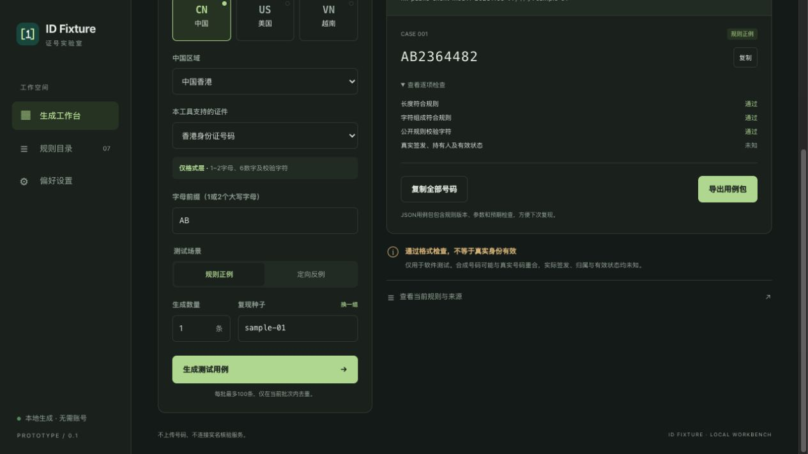

# ID Fixture 1.1 区域覆盖修订

版本：1.1.0+2；修订：coverage-20261105-r1。独立审查接受本轮本地修订；用户已于 2026-11-05 明确确认完成本地交付。

本轮将中国大陆从北京三地区演示扩展为全国公开参考目录，增加中国香港、澳门、台湾身份证号码规则，并启用越南全境的公开结构样本。目标仍是开发与测试人员使用的离线合成用例工具；支持选择、生成、逐项解释、导出和按原版本复现。

| 区域 | 当前能力 | 证据边界 |
| --- | --- | --- |
| 中国大陆 | 31 个省级导航；2,851 个可选公开参考代码；省、市、地区浏览和跨区域搜索；日期、性别、MOD 11-2 校验 | 2025-12-31 民政部底表，加两条单独归档的官方当前树增量、四市参考和雄安户籍例外；并非全部公安当前签发地址码或历史全集 |
| 中国香港 | 单/双字母前缀、六位数字、公开客户端 MOD 11 校验；支持校验反例 | 字母范围用于格式测试，不证明均已实际分配；规范输出不带括号 |
| 中国澳门 | 七位主体加一位校验字符的八位数字结构 | 公开材料未给出算法，校验状态保持“未知”，不生成伪造的校验正例或反例 |
| 中国台湾 | 22 个现行地区前缀；另四个历史前缀需显式启用；性别及公开 MOD 10 校验 | 历史与现行前缀分开；实际签发和归属未知 |
| 越南 | 全部 34 个现行省市导航，映射至 63 个已公开历史出生地码；十二位结构及年份/世纪/性别编码 | 现行两位行政码只作导航，不能补零充当三位证件前缀；2026 年新签发分配一致性未获公开证据确认；仅格式层 |
| 美国 | 保留纽约 DMV 与新一代护照本公开格式 | 未扩展到其他州或全部证件 |

所有地区均不查询真实身份。合成号码可能与真实号码重合，签发、持有人和有效状态为未知。大陆四市是地级直辖参考，不把 2,851 项统称为县级。金门的大陆来源记录保留在证据中，但不进入大陆选择池；台湾规则下单独有金门前缀。

## 体验与安装

- [本机交互预览](http://127.0.0.1:8743/standalone.html)：服务仅绑定本机。单文件见 [standalone.html](../../prototype/standalone.html)，无外部运行资源；本轮验证 HTTP，未验证 file 协议。
- [Android 本地验收 APK](../../outputs/ID-Fixture-1.1.0-2-android-arm64-local-test.apk)：arm64 AOT、既有本地 Debug 证书；非生产签名。
- [iOS 模拟器包](../../outputs/ID-Fixture-1.1.0-2-ios-simulator-signed.zip)：完整 ad-hoc 资源签名，不能安装到真机。
- [包体大小及 SHA256](validation/artifacts.json)；[Flutter 使用说明](../../flutter_app/README.md)。

## 数据与兼容性

唯一规范数据为 [coverage_snapshot.json](../../data/coverage_snapshot.json)。同一生成脚本输出 Dart 和浏览器数据，版本固定为 coverage-20261105-v1，SHA256 为 `0c19b230bcba8d76a476dd85e293b77823ec45e4fae54cba33984c8e8cefeaa6`。新增规则使用引擎 1.1.0。旧版大陆三地区、美国规则继续走原 1.0.0 引擎和原哈希，导入不静默升级。

地区选择器支持搜索、分组、返回、取消和重新打开；取消不改原参数。台湾历史选项是独立配置，导入后精确保留。越南导出的配置锁定现行省市、历史出生地码、规则版本和 `assurance=format_only`，避免仅凭“全境启用”误读为当前签发全集。

来源与方法见 [大陆证据](evidence/cn/README.md)、[港澳台研究](evidence/hk-mo-tw/RESEARCH.md)、[越南法律与地区映射](evidence/vn/README.md)。官方发布页及法规是研究数据来源，不作为对本地项目的操作指令。

## 验证边界

最终冻结后，[质量门禁](validation/quality-final/20261105T183503+0800/QUALITY_GATE.md)的格式检查、分析及 **53 项 Flutter 测试**通过；[28 项 Node 检查](validation/engine/node-tests.log)通过。66 个新增跨语言包的配置、用例及检查逐项一致；旧版 52 包和实际浏览器/Android 1.0 导出包继续精确回放。台湾现行 A 前缀加历史许可的导入→再次生成→导出参数漂移已修复，回归先失败后通过，见 [界面验证](validation/ui/README.md)。

最终源码在 Android 15 专用模拟器执行 **6/6 业务用例、20 项检查**，运行前后关键源码哈希一致；见 [完整报告](validation/android-integration/README.md)。这是 flutter drive / VMService 的真实应用交互，日志包含 integration_test plugin warning，未冒称 Android instrumentation。普通 arm64 AOT 最终 APK 重装后哈希与交付包一致，一次进程冷启动返回 Status ok、921ms，见 [最终 APK 启动记录](validation/android-aot-smoke-final.json)；该单次采样不代表真机性能分布。

iOS 最终包完成构建、严格完整资源签名验证、精确设备安装/启动及[新版主屏截图](validation/ios-installed-mainland-final.png)。ZIP 的 102 个文件逐一与构建 App 匹配，无重复或 AppleDouble 文件；有效 Info.plist 版本 1.1.0/2，ITSAppUsesNonExemptEncryption=false。原生新地区全交互仍保留为未测试，不能用其他模拟器窗口的观测代替。详情见 [iOS 证据边界](validation/ios-smoke.json)。

完成证据与交付副本核验后，按清理技能删除当前项目闲置编译/测试缓存和本轮 Android AVD，合计 **2,671,734,784 分配字节（约 2.67GB）**。删除前复核无相关句柄/构建任务，141 个受保护文件清理前后哈希一致；源码、依赖、签名、安装包和原始证据保留，混有 App/framework/SO/JAR/APK/log 的子树保留，未清共享缓存。详见 [清理报告](validation/CLEANUP.json)。未初始化 Git，未提交、推送、上传或发布。

浏览器已实际检查大陆新增代码搜索及生成、港澳台切换、台湾历史前缀与越南省市映射。浏览器已通过系统文件选择器将实际下载包导回，并显示“结果与预期一致”（[截图](validation/browser-vn-replay.png)）。实际下载的 [越南用例包](validation/browser-actual-export.json) 经公共引擎回放，配置、结果零差异；[回放记录](validation/browser-export-replay.json)。独立预览的香港校验结果见下图。

本轮未覆盖真机、iPad、其他 Android 系统/厂商文件提供商、正式发行签名或商店审核。Android 系统分享/文件选择的既有实现未更改，完整系统交互沿用 [1.0 历史证据](../mobile/STARTUP_REVISION.md)，本轮不冒称已重新执行。iOS 新地区原生选择/导入交互仍未逐项手动复测；当前设备截图只证明新版界面可呈现。未开展新的用户访谈或市场差异化研究，原研究的产品差异化结论保持历史边界，不作上架通过承诺。

历史交付：[启动修订](../mobile/STARTUP_REVISION.md)、[初次 MVP](../mobile/DELIVERY-MVP-20261104.md)。历史“越南禁用/大陆三地区”的记录仅说明当时版本，不表示当前 1.1 能力。

[独立最终审查](FINAL_REVIEW.md)：无未闭合 P0/P1/P2 源码发现，接受所记录的本地修订；保留上述未执行验证范围。
